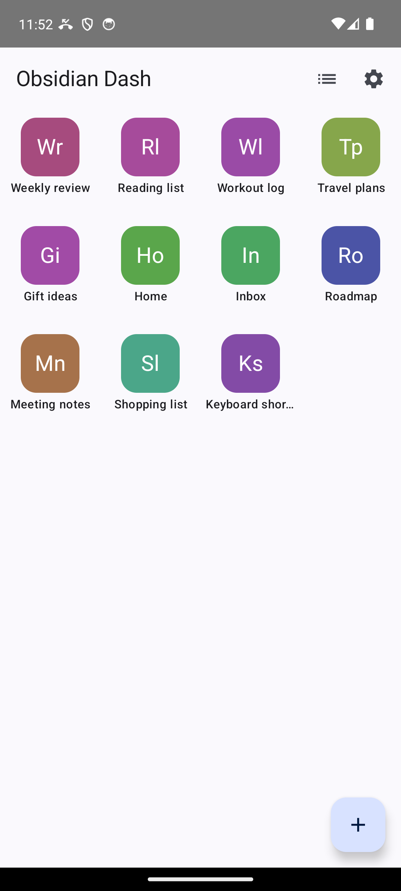
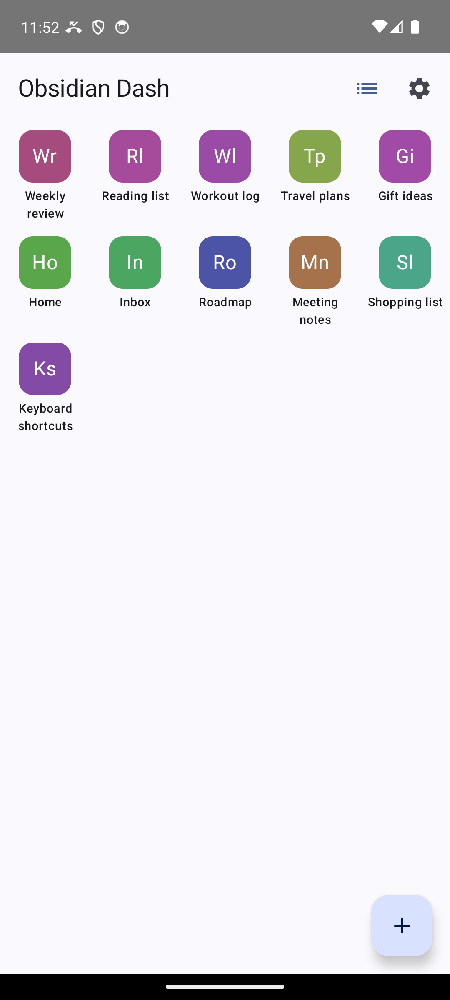
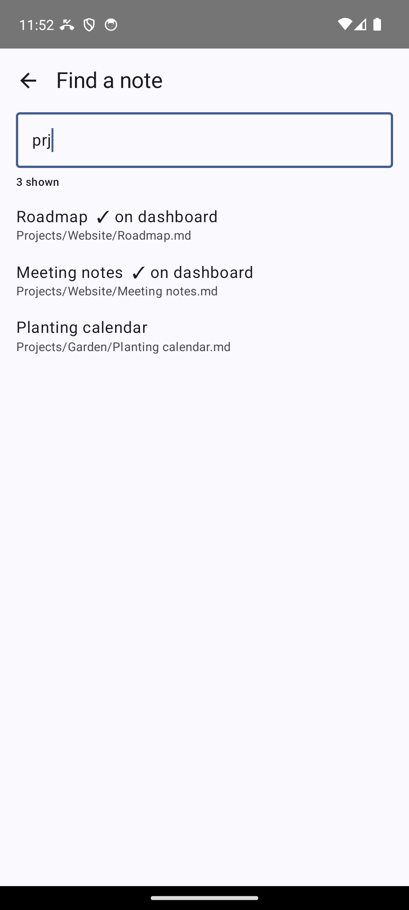
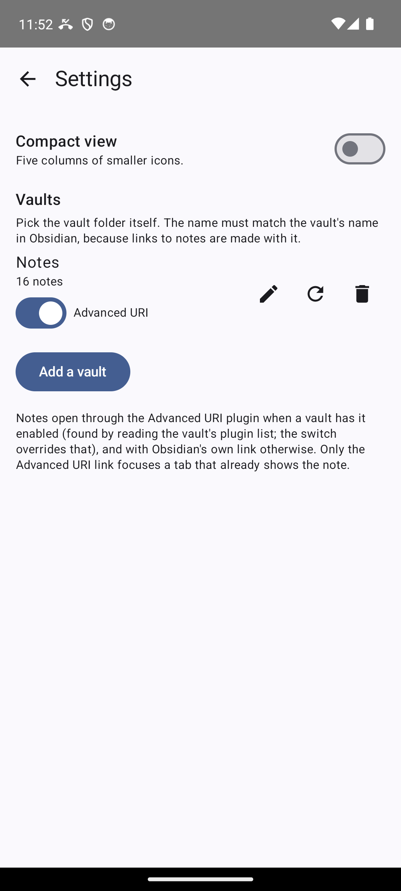

# Obsidian Dash

A home-screen-style dashboard of icons, one per Obsidian note you open often. Tap an icon and
the note opens in Obsidian.

## Use

- In Settings, **Add a vault** and pick the vault's folder (read-only access). Add as many
  vaults as you like.
- Tap **+**, type part of a note's name or path (fuzzy: `mtng` finds "Meeting notes"), and tap
  the result. The note is on the dashboard. With nothing typed, the list shows recently
  changed notes.
- Long press an icon and drag it to any free cell; dropping it on another icon swaps the two.
  Icons stay where you put them. Long press without moving to rename or remove.
- The list icon in the top bar switches to a compact view with 5 columns; each view keeps its
  own arrangement.
- The grid fits the screen exactly, so it does not scroll.

## How notes open

If a vault has the [Advanced URI](https://github.com/Vinzent03/obsidian-advanced-uri) plugin
enabled, the app uses its link with `openmode=true`: a note that is already open in a tab is
focused instead of opened a second time. The app finds out by reading the vault's plugin list
(`.obsidian/community-plugins.json`) each time it reads the vault. Without the plugin it uses
Obsidian's own link, which opens the note but may open it again. In Settings, a switch per vault
overrides the finding; **Auto** hands the decision back.

The vault name in Settings must match the vault's name in Obsidian (by default the folder
name); links are made with it.

## Install

With [Obtainium](https://github.com/ImranR98/Obtainium), which also installs updates:

1. Install Obtainium on the phone and allow it to install apps when asked.
2. In Obtainium: **Add app**, enter `https://github.com/t7ko-ai-projects/android-obsidian-dash`,
   tap **Add**, then **Install**. No token is needed; the repository is public.

Without Obtainium, download `obsidian-dash-<version>.apk` from the
[Releases](https://github.com/t7ko-ai-projects/android-obsidian-dash/releases) page and open it.

If Obtainium cannot install the app or an update, often with an unclear error message, the
likely cause is Google Play Protect, which may block apps that are not on Google Play. Install
that version by hand as above; when Play Protect warns about the app, tap **More details**, then
**Install anyway**. Obtainium then sees the installed version and keeps offering updates.

## Building

`powershell -ExecutionPolicy Bypass -File scripts/build.ps1` runs the unit tests and builds a
signed release APK into `dist/` (needs a signing key set in `local.properties`), or use
`gradlew assembleDebug`. `scripts/release.ps1` publishes a GitHub release.
